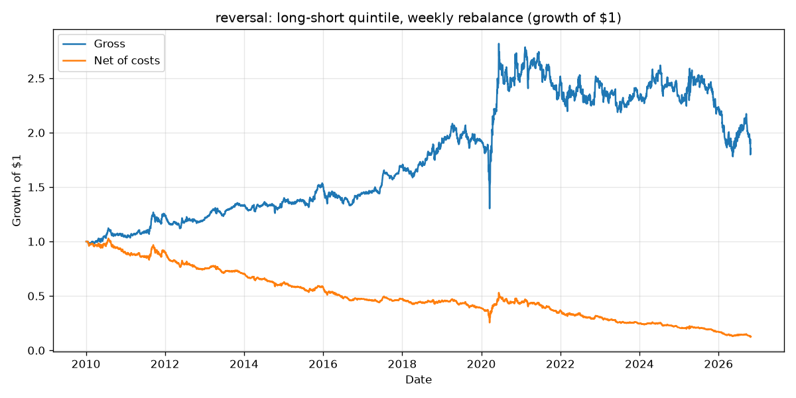

# Equity Signal Backtester

If I had traded on a signal in the past, using only what I could have known at the time, would it have made money after trading costs?

That's the whole question. I built this to answer it for three classic stock signals on the S&P 500 from 2010 to 2026. Python, pandas, PostgreSQL. No backtesting library. I wrote the engine, the timing logic, and the tests myself.

Short answer: mostly no. One signal really does predict returns and still loses money once you pay to trade it. That's the most interesting result here.

## Key results

Long-short quintile portfolios, monthly rebalance, 10 bps cost per unit traded, trade one day after the signal. 498 stocks, 2010-01-04 to 2026-10-26.

| Signal | Gross Sharpe | Net Sharpe | Max drawdown | Mean IC (21d) | Annual turnover |
|---|---|---|---|---|---|
| Momentum (12-1) | 0.13 | 0.06 | -51.0% | 0.0104 | 11.3× |
| Short-term reversal | 0.07 | -0.22 | -56.8% | 0.0102 | 37.3× |
| Low volatility | -0.72 | -0.77 | -95.4% | -0.0286 | 9.9× |
| Equal-weight combo | -0.34 | -0.51 | -80.9% | -0.0011 | 26.1× |
| Random baseline | -0.35 | -1.29 | -59.7% | 0.0001 | 38.4× |
| Walk-forward combo (out-of-sample, 2015–2026) | -0.01 | -0.20 | -54.9% | n/a | 30.0× |

Every number comes from [`reports/results.md`](reports/results.md), which the scripts generate. I don't edit it by hand.



Same strategy, same trades. The only difference between the two lines is trading costs.

## Key findings

- **Reversal is real, but you can't trade it.** Its IC is positive at every horizon, with Newey-West t-stats of 3.18 (5 days), 2.13 (21 days), and 2.01 (63 days). Rebalanced weekly it has a gross Sharpe of 0.32. Net of 10 bps it's -0.74. It trades about 161× its capital a year and breaks even at 3 bps. Real-world costs for most traders are higher than that.
- **Momentum is the only signal that survives costs, barely.** Net Sharpe 0.06 long-short, breakeven around 20 bps. Long-only did better: 20.6% a year net, Sharpe 1.00, about 2.6% a year over an equal-weight benchmark of the same stocks.
- **Low volatility lost 14.6% a year gross as a long-short.** That isn't a broken signal. Long calm stocks, short wild ones is dollar-neutral but not beta-neutral, so the portfolio was effectively short the market during a 16-year bull run. Survivorship bias probably made it worse (see Limitations). Long-only low-vol still made 12.8% a year, just less than the 18.0% benchmark.
- **Fitting weights didn't beat plain momentum.** Out of sample (2015–2026), the walk-forward combo had net Sharpe -0.20. That beat the equal-weight combo (-0.54) and lost to momentum alone (0.04 over the same dates). The fit gave low-vol zero weight in every window and put 100% on reversal from 2019 to 2024.
- **The random baseline behaves.** IC ≈ 0 and t-stats of 0.05, 0.19, and -0.39. Its gross Sharpe of -0.35 is within normal noise for 16 years of data (the standard error of a Sharpe over 16 years is about 0.25). After costs it's -1.29, which is a good picture of what costs do to a strategy with no edge.

## Method

**Data.** Daily adjusted closes for current S&P 500 members from Yahoo Finance (`yfinance`), 2010-01-04 to 2026-10-26, stored in PostgreSQL. 503 tickers downloaded, 5 dropped for having under 2 years of history, 498 left. Missing prices are forward-filled for at most 5 days. Never back-filled.

**Signals.** All computed at close *t* from closes up to *t*.

| Signal | Formula | Idea |
|---|---|---|
| Momentum 12-1 | `price[t-21] / price[t-252] - 1` | Last year's winners keep winning. Skip the last month. |
| Short-term reversal | `-(price[t] / price[t-5] - 1)` | Last week's losers bounce. |
| Low volatility | `-std(daily returns, 60 days)` | Calm stocks have had better risk-adjusted returns. |
| Random | uniform noise per stock per day | The "no skill" baseline. |

Each signal is ranked across stocks on each date (percentile rank). Dates with fewer than 50 valid stocks are skipped. The equal-weight combo is the average of the three ranks.

**Timing.**

```
close t     compute the signal
close t+1   trade into the new positions
t+2 onward  positions earn returns
```

In code, holdings are `target_weights.shift(2)`. One shift because returns on day *d* run from close *d-1* to close *d*, and one more for the one-day execution lag.

**IC.** Spearman rank correlation, on each date, between the signal at *t* and the forward return from close *t+1* to close *t+1+h*, for h = 5, 21, and 63 days. The t-stat uses Newey-West with *h* lags, because forward returns on neighbouring days overlap.

**Portfolios.** On the last trading day of each month (or week), split stocks into quintiles by signal. Long the top 20% at +1/n each, short the bottom 20% at -1/n each. Dollar-neutral, gross exposure 2. Weights are held fixed between rebalances. Long-only versions hold the top quintile and are compared with an equal-weight benchmark of all stocks.

**Costs.** `cost = turnover × bps / 10,000`, where turnover is the total absolute change in weights. 10 bps baseline. I also ran 0, 5, 20, and 50 bps.

**Walk-forward.** Train on 5 years, test on the next 1 year, step forward a year. Each signal's weight is its mean IC in the training window, with negatives set to 0 and the rest normalised to sum to 1. 22 trading days sit between the end of training and the start of testing. A 21-day label starts one day after its date, so it reaches 22 days ahead. Without the gap, the last training labels would reach into the test year. 12 test years, 2015 to 2026. Only out-of-sample results go in the table.

## How I prevented look-ahead bias

Look-ahead bias means using information you wouldn't have had yet. It's the easiest way to make a backtest look amazing. I handled it in three ways.

**1. One timing rule, everywhere.** Signal at close *t*, trade at close *t+1*, earn from *t+2*. Every function that touches dates says which close it uses in its docstring.

**2. A corruption test.** `tests/test_no_lookahead.py` takes a price history, replaces every price after some date with random garbage, and recomputes. Everything before that date must come out identical. If a signal secretly peeks forward, the garbage leaks back and the test fails. It covers every signal, every transform, and the combo. The same idea is tested on the portfolio weights and the engine (`test_engine.py`) and on the walk-forward weights (`test_walk_forward.py`).

To check the test itself works, I also feed it three deliberately leaky functions: `shift(-1)`, a z-score using the full-period mean, and a centred rolling window. All three get caught.

**3. Red-flag checks in the scripts.** They print a loud warning if mean IC is above 0.10, Sharpe is above 2, weights don't sum to ±1, turnover is zero, or the result moves a lot when the execution lag changes. Simple signals shouldn't do any of that. Two warnings fired on the real run. Neither was a leak. MRNA's +177% day tripped the extreme-return check (see Limitations). The random baseline's weekly net Sharpe of -3.62 tripped the Sharpe check. That one is pure cost: 16.7% a year in costs on a portfolio with 4.4% volatility. Gross, it's +0.22.

## Limitations

- **Survivorship bias.** The universe is *today's* S&P 500. Companies that went bust or got dropped are missing, and stocks that got added *after* big run-ups are included for their whole history. This inflates long returns and probably hurts low-vol, since volatile winners are over-represented.
- **Not beta- or sector-neutral.** Long-short books are dollar-neutral only. Low-vol in particular ends up short the market.
- **Simple costs.** A flat cost per unit traded. No market impact, no bid-ask that varies by stock or over time.
- **No borrow costs** on the short side.
- **No weight drift.** Weights stay at their targets between rebalances instead of drifting with prices.
- **No risk-free rate** in the Sharpe ratio.
- **Yahoo data quality.** I inspected every daily move over 50% by hand. One was wrong: DHR's adjusted price jumps 61% on the Fortive spin-off day (2016-07-05), when the stock actually fell. I blanked DHR's history before that date. MRNA's +177% day on 2026-08-19 had about 45× normal volume, so I kept it, but I couldn't confirm it independently.
- **Partial last year.** The final walk-forward test year is 2026-01-02 to 2026-10-26.
- **How many variations I tried.** 5 signals × 2 portfolio types × 2 rebalance frequencies, plus the walk-forward combo: 21 runs, all logged in the `backtest_runs` table with their full config. Every lookback, the quintile count, and the cost level were fixed in `config.yaml` before I saw any results. Nothing was tuned. I changed one method after seeing results: the IC t-stat. Sampling every *h*-th date gave the random baseline t-stats anywhere from -1.8 to +2.9 depending on the start date, so I switched to Newey-West.

## What I'd do next

- Neutralise beta and sector, so low-vol measures the signal instead of market direction.
- Add a simple risk model and size positions by risk, not equally.
- Use more realistic costs that depend on each stock's spread and volume.
- Use a point-in-time universe (historical index membership) to remove survivorship bias.
- Try more signals: value, quality, earnings revisions.

## How to run

Needs Python 3.11+, Docker, and [uv](https://docs.astral.sh/uv/) (or plain `pip`).

```bash
git clone https://github.com/goutham101/equity-signal-backtester.git
cd equity-signal-backtester

uv venv --python 3.11 .venv
uv pip install --python .venv/bin/python -r requirements.txt -e .

docker compose up -d                              # Postgres 16 on localhost:5434

.venv/bin/python scripts/01_download.py           # ~500 tickers, cached in data/raw/
.venv/bin/python scripts/02_build_signals.py
.venv/bin/python scripts/03_ic_analysis.py
.venv/bin/python scripts/04_backtest.py
.venv/bin/python scripts/05_walk_forward.py       # results in reports/

.venv/bin/pytest                                  # no internet needed; DB test skips without Postgres
```

Want a quick check first? Run `01_download.py --limit 10`, then the other scripts with `--smoke`. Smoke runs write to `data/smoke/` and never log to `backtest_runs`.

All parameters live in `config.yaml`. `end_date` is pinned to 2026-10-26 so the numbers above reproduce. Yahoo revises data now and then, so expect small differences.

**macOS note:** if `import backtester` fails, macOS has probably set the hidden flag on the `.pth` files in `.venv`, and Python skips hidden `.pth` files. The quickest fix is `ln -sfn "$PWD/src/backtester" .venv/lib/python3.11/site-packages/backtester`.

## Project structure

```
├── config.yaml                 # every parameter
├── docker-compose.yml          # Postgres
├── sql/
│   ├── schema.sql              # tickers, prices, backtest_runs
│   └── features.sql            # returns + momentum with window functions
├── src/backtester/
│   ├── data/                   # universe, download, cleaning, Postgres I/O
│   ├── signals/                # momentum, reversal, low-vol, random, ranking
│   ├── analysis/               # forward returns, IC, metrics
│   ├── backtest/               # portfolios, engine, walk-forward
│   ├── reporting/plots.py
│   └── pipeline.py             # shared setup for the scripts
├── scripts/01_…05_*.py         # run the pipeline in order
├── tests/                      # pytest, synthetic data
├── reports/
│   ├── results.md              # generated tables
│   └── figures/
└── docs/dashboard_spec.md      # planned Streamlit dashboard
```

Educational project. Not investment advice.
